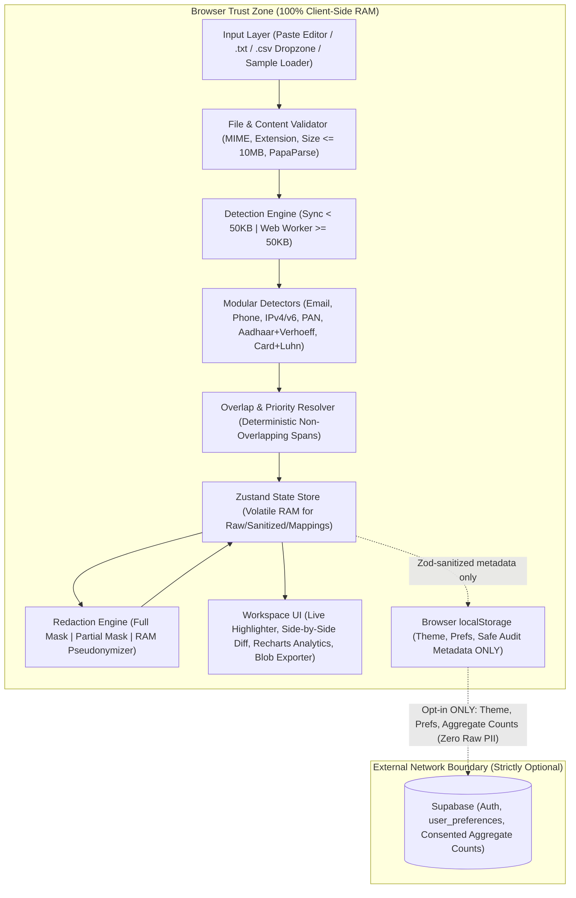
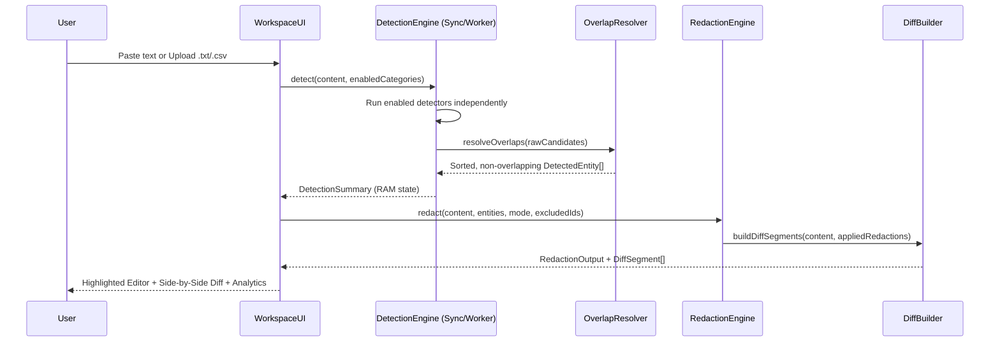

# PrivacyShield AI — System Architecture & Engineering Specification

> **Document Status:** Implemented & Production-Hardened Specification  
> **Project:** PrivacyShield AI — Client-Side PII Detection, Classification & Data Sanitization Platform  
> **Core Guarantee:** 100% Client-Side PII Processing — raw documents, uploaded files, detected values, and pseudonymization mappings never leave the browser.

---

## 1. Requirements Analysis & Engineering Assumptions

PrivacyShield AI is a deterministic, browser-native cybersecurity web application for detecting, classifying, highlighting, comparing, analyzing, and sanitizing Personally Identifiable Information (PII) in pasted text, `.txt` files, and `.csv` datasets.

### Explicit Engineering Assumptions

To eliminate ambiguity before Phase 2 implementation, the following architectural decisions are established:

1. **Workspace Location:** The repository will be initialized at `/Users/anujpote178/.gemini/antigravity/scratch/privacyshield-ai`.
2. **Styling & UI Stack:** React 19 + TypeScript (strict mode) + Vite + Tailwind CSS v4 + shadcn/ui primitives + Framer Motion + Lucide React + Recharts.
3. **Deterministic Engine (Zero External AI Calls):** All detection and redaction logic runs deterministically in TypeScript inside the browser. No external LLM or backend text-processing API is ever called.
4. **Aadhaar Validation Policy:** Detects 12-digit numbers starting with `[2-9]` in contiguous, space-separated (`XXXX XXXX XXXX`), or hyphen-separated (`XXXX-XXXX-XXXX`) forms, verified with the **Verhoeff checksum algorithm** plus boundary guards (rejecting substrings of 16-digit card numbers or long numeric IDs). UI and docs explicitly label this as *format & checksum validation*, never UIDAI verification.
5. **PAN Validation Policy:** Enforces complete 10-character structural format `[A-Z]{3}[ABCFGHLJPT][A-Z][0-9]{4}[A-Z]` (validating the 4th entity-holder character and 5th alphabetic name initial character) with word-boundary guards. Explicitly labeled as *structural validation only*, never government-database verification.
6. **Credit Card Validation Policy:** Extracts candidate 13–19 digit sequences (bare, space-separated, or hyphen-separated), strips separators, rejects degenerate patterns (e.g., all identical digits), verifies valid length/prefix structure, and enforces **Luhn mod-10 checksum** validation.
7. **Indian Phone Number Policy:** Detects `+91`, `91`, `0`, or bare 10-digit Indian mobile numbers starting with `[6-9]`, allowing common space/hyphen separators while rejecting numeric substrings embedded in longer digit strings, timestamps, or IDs.
8. **IP Address Partial Masking Policy:**
   - **IPv4:** Preserves the first two octets (`/16` network context) and masks the remaining octets (e.g., `192.168.1.42` → `192.168.xxx.xxx`).
   - **IPv6:** Preserves the first two hextets and masks the remaining segments (e.g., `2001:0db8:85a3::8a2e:0370:7334` → `2001:0db8:xxxx:xxxx:xxxx:xxxx:xxxx:xxxx`).
9. **Pseudonymization Normalization & Lifecycle:**
   - Entities are normalized before lookup (lowercased emails, 10-digit canonical phones, uppercase PANs, digit-only Aadhaar/cards, canonical IPv4/IPv6) so formatting variations of the same sensitive entity resolve to the exact same placeholder (`USER_01`, `PHONE_01`, `IP_01`, `PAN_01`, `AADHAAR_01`, `CARD_01`).
   - Mappings exist **strictly in volatile browser RAM** (never in `localStorage`, `sessionStorage`, `IndexedDB`, or Supabase).
   - Mappings reset automatically when loading a new file/sample (unless the user explicitly enables session-persistent mapping for the current tab), clicking **Reset Mappings** / **Clear Workspace**, or closing/reloading the page.
10. **Large Input Performance:** Documents under 50 KB run synchronously for instant feedback (< 5 ms). Documents ≥ 50 KB or CSVs with > 500 rows automatically offload to a dedicated browser **Web Worker** (`detection.worker.ts`) with progress updates so the main UI thread never freezes. Upload size is capped at 10 MB.
11. **Optional Supabase Backend:** Supabase is strictly optional. If `VITE_SUPABASE_URL` / `VITE_SUPABASE_ANON_KEY` are missing or unreachable, the app transparently enters **Local-Only Mode** with zero loss of core sanitization functionality.

---

## 2. System Architecture & Privacy Boundaries

### High-Level Architecture Diagram



### Data Classification & Trust Boundary Matrix

| Data Category | Volatile RAM (Zustand / Worker) | Browser `localStorage` | Supabase (Opt-In Only) | Console / Error Logs |
| :--- | :---: | :---: | :---: | :---: |
| Raw pasted text / uploaded file bytes | Yes (cleared on reset/unload) | **NEVER** | **NEVER** | **NEVER** |
| Detected raw PII values (`entity.value`) | Yes (ephemeral) | **NEVER** | **NEVER** | **NEVER** |
| Pseudonymization lookup tables | Yes (ephemeral) | **NEVER** | **NEVER** | **NEVER** |
| Sanitized output text / CSV | Yes (ephemeral) | **NEVER** | **NEVER** | **NEVER** |
| UI Theme, Default Mode, Category Toggles | Yes | Yes | Optional (authenticated) | Safe |
| Activity Log Metadata (timestamp, action, counts, mode) | Yes | Yes (Zod-validated) | **NEVER** raw log | Safe |
| Aggregate Entity Counts (no text, no filenames) | Yes | Yes | Opt-in consent only | Safe |

> [!IMPORTANT]
> The `"100% Client-Side Processing"` badge is backed by an enforceable network boundary: during paste, upload, detection, redaction, diffing, and download, **zero network requests** leave the browser. This will be verified by automated Playwright network interception tests in Phase 10.

---

## 3. Repository & File Structure

```text
privacyshield-ai/
│
├── frontend/
│   ├── public/
│   │   ├── logo.svg
│   │   └── favicon.svg
│   │
│   ├── src/
│   │   ├── assets/
│   │   │
│   │   ├── components/
│   │   │   ├── common/          # ErrorBoundary, PrivacyBadge, ThemeToggle, InteractiveHeroPreview, PrivacyArchitectureSection, RedactionModesShowcase, FaqAccordion, SectionHeader
│   │   │   ├── layout/          # AppShell, Navbar, Footer, WorkspaceSidebar
│   │   │   ├── editor/          # TextInputEditor, FileUploadZone
│   │   │   ├── detection/       # HighlightedTextView, CategoryControlsBar, DetectionResultsTable
│   │   │   ├── redaction/       # RedactionControlsBar (incl. Restore AI Reply), SideBySideDiffView
│   │   │   ├── analytics/       # AnalyticsDashboard
│   │   │   └── ui/              # shadcn/ui primitives (Button, Card, Tabs, Badge, Switch)
│   │   │
│   │   ├── pages/
│   │   │   ├── HomePage.tsx
│   │   │   ├── WorkspacePage.tsx
│   │   │   ├── HistoryPage.tsx
│   │   │   ├── AboutPage.tsx
│   │   │   └── NotFoundPage.tsx
│   │   │
│   │   ├── hooks/               # useSanitizationPipeline.ts, useTheme.ts
│   │   ├── store/               # useWorkspaceStore.ts, usePreferencesStore.ts, useAuditLogStore.ts
│   │   │
│   │   ├── services/
│   │   │   ├── detection/
│   │   │   │   ├── detectionEngine.ts
│   │   │   │   ├── detection.worker.ts
│   │   │   │   ├── emailDetector.ts
│   │   │   │   ├── phoneDetector.ts
│   │   │   │   ├── ipDetector.ts
│   │   │   │   ├── panDetector.ts
│   │   │   │   ├── aadhaarDetector.ts
│   │   │   │   ├── verhoeffValidator.ts
│   │   │   │   ├── creditCardDetector.ts
│   │   │   │   ├── luhnValidator.ts
│   │   │   │   ├── overlapResolver.ts
│   │   │   │   └── index.ts
│   │   │   │
│   │   │   ├── redaction/
│   │   │   │   ├── redactionEngine.ts
│   │   │   │   ├── fullMasker.ts
│   │   │   │   ├── partialMasker.ts
│   │   │   │   ├── pseudonymizer.ts
│   │   │   │   ├── diffBuilder.ts
│   │   │   │   └── index.ts
│   │   │   │
│   │   │   ├── export/
│   │   │   │   ├── fileExporter.ts
│   │   │   │   ├── reportExporter.ts
│   │   │   │   └── index.ts
│   │   │   │
│   │   │   ├── csv/
│   │   │   │   ├── csvParser.ts
│   │   │   │   ├── csvSanitizer.ts
│   │   │   │   └── index.ts
│   │   │   │
│   │   │   └── supabase/
│   │   │       ├── supabaseClient.ts
│   │   │       ├── preferencesService.ts
│   │   │       ├── statisticsService.ts
│   │   │       └── index.ts
│   │   │
│   │   ├── utils/               # fileValidation.ts, cn.ts, formatters.ts, safeMaskPreview.ts
│   │   ├── types/               # detection.ts, redaction.ts, csv.ts, audit.ts, analytics.ts, supabase.ts
│   │   ├── constants/           # piiCategories.ts, sampleData.ts, limits.ts
│   │   ├── styles/              # globals.css, tokens.css
│   │   ├── App.tsx
│   │   └── main.tsx
│   │
│   ├── tests/
│   │   ├── unit/                # Individual tests for all 6 detectors, Luhn, Verhoeff, overlap, redaction, CSV
│   │   ├── integration/         # End-to-end service/UI pipeline tests via Vitest + RTL
│   │   └── e2e/                 # Playwright browser + network-privacy + mobile layout specs
│   │
│   ├── index.html
│   ├── package.json
│   ├── tsconfig.json
│   ├── vite.config.ts
│   ├── vitest.config.ts
│   ├── playwright.config.ts
│   └── vercel.json
│
├── backend/
│   ├── supabase/
│   │   ├── migrations/
│   │   │   └── 0001_init_privacyshield_metadata.sql
│   │   ├── seed.sql
│   │   └── config.toml
│   │
│   ├── types/
│   │   └── database.types.ts
│   └── README.md
│
├── docs/
│   ├── ARCHITECTURE.md
│   ├── PRIVACY_POLICY.md
│   ├── SECURITY.md
│   ├── API_DOCUMENTATION.md
│   └── TESTING.md
│
├── .gitignore
├── README.md
└── package.json
```

---

## 4. Core TypeScript Interfaces & Schemas

### Detection Types (`frontend/src/types/detection.ts`)

```typescript
export type PIIType =
  | "EMAIL"
  | "PHONE"
  | "IP_ADDRESS"
  | "PAN"
  | "AADHAAR"
  | "CREDIT_CARD";

export type ValidationMethod =
  | "RFC_PATTERN"
  | "INDIAN_MOBILE_RULE"
  | "IPV4_OCTET_CHECK"
  | "IPV6_RFC4291_CHECK"
  | "PAN_STRUCTURE_CHECK"
  | "VERHOEFF_CHECKSUM"
  | "LUHN_CHECKSUM";

export interface DetectedEntity {
  id: string;
  type: PIIType;
  value: string;           // Held in volatile RAM only; never logged or persisted
  start: number;           // Inclusive UTF-16 code unit offset
  end: number;             // Exclusive UTF-16 code unit offset
  confidence: number;      // Deterministic score in [0.0, 1.0]
  validationMethod: ValidationMethod;
  cellLocation?: {
    row: number;
    col: number;
    columnName?: string;
  };
}

export interface DetectionOptions {
  enabledCategories: Record<PIIType, boolean>;
}

export interface DetectionSummary {
  entities: DetectedEntity[];
  countsByCategory: Record<PIIType, number>;
  totalDetected: number;
  durationMs: number;
  usedWorker: boolean;
}
```

### Redaction & Diff Types (`frontend/src/types/redaction.ts`)

```typescript
export type RedactionMode = "FULL_MASK" | "PARTIAL_MASK" | "PSEUDONYMIZE";

export type FullMaskVariant = "CATEGORY_TAG" | "GENERIC";

export interface RedactionConfig {
  mode: RedactionMode;
  fullMaskVariant: FullMaskVariant;
  excludedEntityIds: ReadonlySet<string>;
}

export interface AppliedRedaction {
  entityId: string;
  type: PIIType;
  originalStart: number;
  originalEnd: number;
  sanitizedStart: number;
  sanitizedEnd: number;
  replacement: string;
  wasExcluded: boolean;
}

export interface DiffSegment {
  id: string;
  kind: "unchanged" | "redacted" | "excluded";
  originalText: string;
  sanitizedText: string;
  entityId?: string;
  entityType?: PIIType;
}

export interface RedactionOutput {
  sanitizedText: string;
  appliedRedactions: AppliedRedaction[];
  diffSegments: DiffSegment[];
  redactedCount: number;
  excludedCount: number;
}
```

### CSV, Audit & Analytics Types

```typescript
export interface ParsedCsvDocument {
  fileName: string;
  fileSizeBytes: number;
  delimiter: string;
  linebreak: string;
  hasHeader: boolean;
  headers: string[];
  rows: string[][];
}

export type AuditAction =
  | "SAMPLE_DATA_LOADED"
  | "FILE_SELECTED"
  | "DETECTION_COMPLETED"
  | "REDACTION_MODE_CHANGED"
  | "SANITIZATION_COMPLETED"
  | "FILE_DOWNLOADED"
  | "MAPPINGS_RESET"
  | "WORKSPACE_CLEARED"
  | "PRIVACY_REPORT_EXPORTED";

export interface AuditLogEntry {
  id: string;
  timestamp: string;           // ISO-8601
  action: AuditAction;
  detectedCount?: number;
  redactedCount?: number;
  redactionMode?: RedactionMode;
  status: "SUCCESS" | "WARNING" | "ERROR";
  note?: string;               // Strictly sanitized static/metadata message only
}
```

---

## 5. Detection & Redaction Engine Design

### Processing Pipeline



### Overlap Resolution Priority

When two detectors match overlapping spans (for example, a 16-digit credit card contains 10-digit and 12-digit numeric substrings), `overlapResolver.ts` applies deterministic priority rules:

1. **Specificity Priority:** `CREDIT_CARD` (6) > `AADHAAR` (5) > `EMAIL` (4) > `IP_ADDRESS` (3) > `PAN` (2) > `PHONE` (1).
2. **Span Length:** Longer span wins when priority is equal.
3. **Confidence Score:** Higher deterministic confidence wins.
4. **Start Offset:** Earlier start index wins as final tie-breaker.

### CSV Sanitization Integrity

- CSV files are parsed with `Papa.parse(rawText, { header: false, skipEmptyLines: false })` to retain exact row/column structure, delimiters, and embedded commas/newlines inside quoted fields.
- Detection and redaction run **cell-by-cell** so values in adjacent columns never bleed across delimiters.
- In `PSEUDONYMIZE` mode, a single `PseudonymMap` instance spans the entire CSV document so repeated entities across rows/columns receive identical placeholders (`USER_01`, `CARD_01`, etc.).
- Export reconstructs the CSV using `Papa.unparse(sanitizedRows, { delimiter, newline, quotes: false })`, automatically quoting fields that contain delimiters, quotes, or newlines without corrupting the schema.

---

## 6. Supabase Integration Plan (Metadata Only)

### Database Schema (`backend/supabase/migrations/0001_init_privacyshield_metadata.sql`)

```sql
-- User Preferences (authenticated opt-in only)
CREATE TABLE public.user_preferences (
  id UUID PRIMARY KEY DEFAULT gen_random_uuid(),
  user_id UUID NOT NULL UNIQUE REFERENCES auth.users(id) ON DELETE CASCADE,
  theme TEXT NOT NULL DEFAULT 'dark' CHECK (theme IN ('dark', 'light')),
  default_redaction_mode TEXT NOT NULL DEFAULT 'FULL_MASK'
    CHECK (default_redaction_mode IN ('FULL_MASK', 'PARTIAL_MASK', 'PSEUDONYMIZE')),
  telemetry_consent BOOLEAN NOT NULL DEFAULT FALSE,
  created_at TIMESTAMPTZ NOT NULL DEFAULT now(),
  updated_at TIMESTAMPTZ NOT NULL DEFAULT now()
);

-- Aggregate Sanitization Statistics (strictly counts — zero text/PII columns)
CREATE TABLE public.sanitization_statistics (
  id UUID PRIMARY KEY DEFAULT gen_random_uuid(),
  user_id UUID NULL REFERENCES auth.users(id) ON DELETE SET NULL,
  email_count INTEGER NOT NULL DEFAULT 0 CHECK (email_count >= 0),
  phone_count INTEGER NOT NULL DEFAULT 0 CHECK (phone_count >= 0),
  ip_count INTEGER NOT NULL DEFAULT 0 CHECK (ip_count >= 0),
  pan_count INTEGER NOT NULL DEFAULT 0 CHECK (pan_count >= 0),
  aadhaar_count INTEGER NOT NULL DEFAULT 0 CHECK (aadhaar_count >= 0),
  credit_card_count INTEGER NOT NULL DEFAULT 0 CHECK (credit_card_count >= 0),
  total_entities INTEGER NOT NULL DEFAULT 0 CHECK (
    total_entities = email_count + phone_count + ip_count + pan_count + aadhaar_count + credit_card_count
  ),
  redaction_mode TEXT NOT NULL CHECK (redaction_mode IN ('FULL_MASK', 'PARTIAL_MASK', 'PSEUDONYMIZE')),
  created_at TIMESTAMPTZ NOT NULL DEFAULT now()
);
```

### Security Controls

- **Row Level Security (RLS):** Enabled on every table.
  - `user_preferences`: Authenticated users can only access rows where `auth.uid() = user_id`.
  - `sanitization_statistics`: Inserts allowed for authenticated users (`auth.uid() = user_id`) or consented anonymous sessions (`user_id IS NULL`); users can only read their own rows; landing page statistics use a restricted aggregate view/RPC returning sums only.
- **Zod Runtime Guard:** Every outbound Supabase payload passes through a strict `.strict()` Zod schema in `frontend/src/services/supabase/` that rejects any extra properties before transmission.
- **Fallback Mode:** Missing `VITE_SUPABASE_URL` / `VITE_SUPABASE_ANON_KEY` disables cloud calls cleanly with zero console errors.

---

## 7. Security & Visual Design Standards

### Privacy Verification Module (`frontend/src/services/privacy/`)

As an explicit architectural safeguard, PrivacyShield AI includes a dedicated **Privacy Verification Module** that validates zero-leak guarantees across five attack surfaces:

1. **Network Boundary Verification:** Confirms no raw document content or detected PII substrings appear in outbound `fetch`/`XMLHttpRequest` calls (and zero external calls occur in Local-Only Mode).
2. **Browser Storage Verification:** Audits `localStorage` and `sessionStorage` to guarantee zero raw text, uploaded filenames, detected PII values, or pseudonymization maps are ever persisted.
3. **Console & Error Hygiene Verification:** Inspects structured telemetry/log payloads to ensure raw values are never emitted to console logs or error boundaries.
4. **Analytics Payload Verification:** Validates that local analytics objects contain only aggregate counts and structural metrics — never entity values.
5. **Supabase Payload Guard Verification:** Enforces strict `.strict()` Zod validation on all optional cloud writes so any unexpected key or raw text is rejected before transmission.

### Security Hardening Checklist

- No `dangerouslySetInnerHTML` anywhere in the codebase.
- Strict Content Security Policy (`vercel.json` headers): restricts script execution to `'self'`, forbids framing (`frame-ancestors 'none'`), and limits `connect-src` to `'self'` and configured Supabase HTTPS origin.
- File upload validation checks extension (`.txt`, `.csv`), MIME allowlist, file size (`<= 10 MB`), and binary/null-byte detection before reading as UTF-8 text.
- `URL.revokeObjectURL()` invoked immediately after triggering Blob downloads.
- Entity inspector panels mask sensitive values by default (with an explicit opt-in reveal toggle per item) so PII is not needlessly exposed on screen.

### Design Tokens & Accessibility

- **Theme Palette:** Dark mode primary (`#060913` canvas, `#0D1424` elevated surfaces, `#1E293B` subtle borders) + crisp Light mode (`#F8FAFC` canvas, `#FFFFFF` cards).
- **Accents:** Electric Blue (`#3B82F6`), Cyber Violet (`#8B5CF6`), Verified Emerald (`#10B981`).
- **Category Semantic Colors (WCAG AA compliant in dark & light themes):**
  - `EMAIL`: Blue (`#3B82F6`)
  - `PHONE`: Purple (`#A855F7`)
  - `IP_ADDRESS`: Cyan (`#06B6D4`)
  - `PAN`: Orange (`#F97316`)
  - `AADHAAR`: Pink (`#EC4899`)
  - `CREDIT_CARD`: Red (`#EF4444`)
- **Typography:** `Inter` for UI hierarchy, `JetBrains Mono` for editors, highlighted entities, diff views, and numeric counters.

---

## 8. Phased Implementation Plan (Phases 1–11)

| Phase | Scope & Key Deliverables | Verification Gate |
| :--- | :--- | :--- |
| **Phase 1** | **Planning & Architecture** — Requirements analysis, architecture, TypeScript interfaces, privacy boundaries, Supabase schema, implementation plan (`docs/ARCHITECTURE.md`). | User approval required before Phase 2. |
| **Phase 2** | **Project Setup** — React 19 + TS + Vite + Tailwind + shadcn/ui + Router + Zustand + Vitest + ESLint/Prettier + folder structure + design tokens + SVG logo/favicon. | `tsc --noEmit`, `npm run build`, dev server render check. |
| **Phase 3** | **Landing Page & Design System** — Complete responsive cybersecurity SaaS landing page, interactive preview, theme switcher, real stats integration hooks, FAQ, footer. | Build, responsive desktop/mobile verification, navigation & theme test. |
| **Phase 4** | **Workspace Interface** — Sidebar shell, paste editor with counts/clear/undo-redo, drag-and-drop `.txt`/`.csv` upload with validation, realistic synthetic sample loader (mock detections isolated for UI only). | Build, file upload/error handling check, workspace UI inspection. |
| **Phase 5** | **PII Detection Engine** — All 6 modular detectors, Luhn validator, Verhoeff validator, overlap resolver, Web Worker offload, comprehensive unit tests (true/false positives). | All detector unit tests green, `tsc` + build clean. |
| **Phase 6** | **Redaction Engine** — Full mask (category + generic), partial mask, consistent RAM pseudonymizer, per-entity exclusion, mapping reset, unit tests. | All redaction & pseudonymization unit tests green. |
| **Phase 7** | **Diff, Highlighting & Analytics** — Live color-coded editor highlights, interactive entity popover, synchronized side-by-side diff viewer, Recharts analytics dashboard, browser-local privacy report. | Live browser verification across desktop & mobile, mode switch reactivity. |
| **Phase 8** | **CSV & TXT Processing + Export** — Cell-safe CSV parsing/sanitization preserving delimiters/quotes, Blob `.txt`/`.csv` download with `revokeObjectURL`, toast feedback. | Unit + integration tests with complex quoted CSVs and multiline TXTs. |
| **Phase 9** | **Audit Log & Supabase** — Local-first Zod-safe activity log, export/clear history, Supabase SQL migration + RLS + optional auth/preferences/consented aggregate stats, privacy docs (`PRIVACY_POLICY.md`, `SECURITY.md`, `API_DOCUMENTATION.md`). | Offline/no-Supabase test + zero-PII storage verification. |
| **Phase 10** | **Complete Automated Testing** — Full Vitest unit + RTL integration + Playwright E2E + Network/Console/Storage privacy security suite + `docs/TESTING.md`. | 100% critical tests passing; zero console errors; zero PII network leaks. |
| **Phase 11** | **GitHub & Vercel Deployment** — Clean git repo, `.gitignore`, `README.md`, `vercel.json` (SPA fallback + CSP), production Vercel deployment and live verification. | Live deployed URL verified across all flows and privacy checks. |
